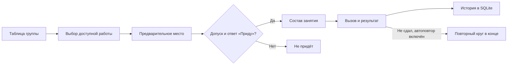

<p align="center">
  <picture>
    <source media="(prefers-reduced-motion: reduce)" srcset="docs/assets/readme/hero.svg">
    
  </picture>
</p>

<div align="center">

# Lab Grader · Defense Queue

**От успешной проверки работы до защиты на занятии.**

<p>
  <a href="docs/queue/VERIFICATION.md"></a>
</p>
<p>
  <a href="https://github.com/kotysheff/lab-grader-queue/actions/workflows/tests.yml"></a>
  <a href="LICENSE"></a>
</p>

[Посмотреть за 5 минут](docs/queue/SANDBOX.md) · [Рабочий запуск](docs/queue/RUNBOOK.md) · [Исследование](research/queue-study/README.md) · [ADR](docs/adr/README.md) · [Вся документация](docs/README.md)


</div>

## Что добавлено

В исходном Lab Grader студент выбирает группу и лабораторную, вводит ФИО и GitHub, затем регистрирует результат проверки. Очередь использует допуск из Google Sheets и добавляет список на ближайшее занятие, подтверждение прихода и панель преподавателя.

<table>
<tr>
<td width="33%" valign="top"><strong>01 / Студент</strong><br><br>Вся очередь группы, собственное место и ответ «Приду / не приду». Во время занятия — текущий порядок и результаты без управляющих кнопок.<br><br><a href="docs/queue/RUNBOOK.md#студент">Открыть сценарий →</a></td>
<td width="33%" valign="top"><strong>02 / Преподаватель</strong><br><br>Вызов нескольких студентов, результаты защиты, повторные круги, отмена ошибочного действия, статистика и история.<br><br><a href="docs/queue/ROUNDS.md">Кнопки и состояния →</a></td>
<td width="33%" valign="top"><strong>03 / Расписание</strong><br><br>ГУАП, ручные занятия и JSON-импорт для других вузов. Переносы, отмена и восстановление занятий; отдельные списки групп.<br><br><a href="docs/adr/0003-schedule-adapters.md">Устройство расписания →</a></td>
</tr>
</table>

> [!IMPORTANT]
> Модуль очереди не записывает оценки в Google Sheets. Существующая регистрация работы сохраняет `v`; преподаватель ведёт оценки и `vv` прежним способом.

## Преподавателю: маршрут просмотра

1. **Запустить [песочницу](docs/queue/SANDBOX.md)** и пройти регистрацию студента, вызов, результат и повторную попытку.
2. Открыть **[исследование с графиками](research/queue-study/README.md)**: все модели, три финалиста и основания выбора −1.
3. Прочитать **[архитектурные решения](docs/adr/README.md)**. Версии по шаблону задания находятся [в пакете ADR](docs/hackathon/lab-grader-queue/README.md).
4. Посмотреть **[подтверждённые проверки и отличия от задания](docs/queue/VERIFICATION.md)**.
5. Для собственного курса перейти к **[рабочему запуску](docs/queue/RUNBOOK.md)**.

## Запуск без Docker

Нужны **Python 3.12**, **Node.js 20+** и npm. Команды выполняются из корня репозитория.

<details>
<summary><strong>Первый запуск: установить зависимости</strong></summary>

```bash
python3.12 -m venv .venv
.venv/bin/python -m pip install -r requirements-dev.txt
npm ci --prefix frontend/courses-front --legacy-peer-deps
```

Если Python устанавливается через uv: `uv venv --python 3.12 .venv`. Исследование имеет отдельные зависимости: [инструкция](research/queue-study/README.md).

</details>

| Режим | Команда / инструкция | Внешние доступы |
|---|---|---|
| **Песочница**: полный сценарий на вымышленных данных | `./start-sandbox` | Не нужны; Google/GitHub симулируются |
| **Стенд**: настоящие публичные таблица и расписание | `./start-main` | Интернет; ключи не нужны; регистрация работ отключена |
| **Собственный рабочий сервис**: регистрация, CI и очередь | [Настроить и запустить](docs/queue/RUNBOOK.md#рабочий-сервис-на-своём-курсе) | Собственные GitHub-токен и Google service account |

> [!TIP]
> Для защиты проекта начни с `./start-sandbox`. Одна команда запускает оба сервера. Открой **http://localhost:8010/sandbox**, нажми «Войти», затем перейди в панель преподавателя или на страницу студента. Вход преподавателя: **sandbox / sandbox123** на **http://localhost:5180/admin**.

Порты, сброс, сохранение данных и пошаговые сценарии: [песочница](docs/queue/SANDBOX.md). Запуск на публичных данных: [стенд](docs/queue/LIVE_CHECK.md). `./start-main` не является запуском полноценной регистрации со своими ключами.

## Как строится порядок

```text
priority = max(−1, неделя дедлайна − неделя занятия)

     −1                       0                    +1, +2, …
Просроченные работы     Текущий дедлайн          Будущие сроки
                    раньше → позже
```

Первая готовая работа **после последней защищённой** определяет цель. Пустые ячейки пропускаются: `vv / пусто / v` и `v / vv / v` дают третью работу. Если готовой работы нет, студент получает предварительный приоритет следующей, но подтвердить приход сможет после допуска.

При равных приоритетах сохраняется порядок первоначального состава занятия. В случайном режиме все студенты группы заранее получают сохранённый случайный ключ. Регистрация лабораторной не запускает жеребьёвку повторно. В режиме −1 завершившие все работы в новый список не включаются.



До начала пары студент меняет посещение. Во время занятия и десять минут после него он видит текущую очередь; затем открывается следующее занятие. Преподаватель управляет попытками и отмечает неявку. [Все правила и кнопки](docs/queue/ROUNDS.md).

## Исследование и архитектура

| Материал | Содержание |
|---|---|
| **[Исследование](research/queue-study/README.md)** | Восемь моделей, три финалиста, 10 000 прогонов, графики, чувствительность и экзаменационные сценарии |
| **[ADR-0001 · Приоритет](docs/adr/0001-priority-policy.md)** | Основания выбора −1 и правила формирования списка |
| **[ADR-0002 · SQLite](docs/adr/0002-sqlite-storage.md)** | Варианты хранения, транзакции, уникальность активной попытки и история |
| **[ADR-0003 · Расписание](docs/adr/0003-schedule-adapters.md)** | Вузы, адаптеры, ручные занятия, переносы и отмена |
| **[API](docs/queue/API.md)** | Маршруты студента, преподавателя и настройки |
| **[Проверки](docs/queue/VERIFICATION.md)** | Команды, результаты, покрытые сценарии и границы проверки |

Баллы исследования относятся к синтетической модели. Приложение организует порядок защиты; оно не прогнозирует оценки реальных студентов.

## Карта репозитория

| Путь | Что искать |
|---|---|
| [`grading/defense_queue/`](grading/defense_queue/) | Правила очереди, синхронизация, SQLite, расписание и фоновая сверка |
| [`main.py`](main.py) | HTTP API и подключение к существующей проверке работ |
| [`frontend/courses-front/`](frontend/courses-front/) | Интерфейсы студента и преподавателя, три языка |
| [`courses/`](courses/) | Конфигурации курсов и индекс |
| [`research/queue-study/`](research/queue-study/) | Модели, результаты и графики исследования |
| [`tests/`](tests/) | Проверки логики, хранения, HTTP и песочницы |
| [`scripts/`](scripts/) | Запуск, служебные команды и генерация графики |
| [`docs/`](docs/README.md) | Полная навигация по инструкциям и справочникам |

<details>
<summary><strong>Воспроизвести проверки</strong></summary>

```bash
ADMIN_LOGIN=test ADMIN_PASSWORD=test SECRET_KEY=test GITHUB_TOKEN=dummy QUEUE_WORKER_ENABLED=0 .venv/bin/python -m pytest tests/ -q
npm test --prefix frontend/courses-front
npm run build --prefix frontend/courses-front
./start-sandbox --check
.venv/bin/python scripts/check_docs.py
```

Числа на верхней плашке относятся к локальному прогону от 08.11.2026. Отдельный бейдж GitHub Actions показывает состояние удалённого CI. [Подробный протокол](docs/queue/VERIFICATION.md).

</details>

---

<div align="center">

**Lab Grader Web · очередь защиты лабораторных**

[Запуск](docs/queue/RUNBOOK.md) · [Песочница](docs/queue/SANDBOX.md) · [Документация](docs/README.md) · [Исследование](research/queue-study/README.md) · [MIT](LICENSE)

</div>
