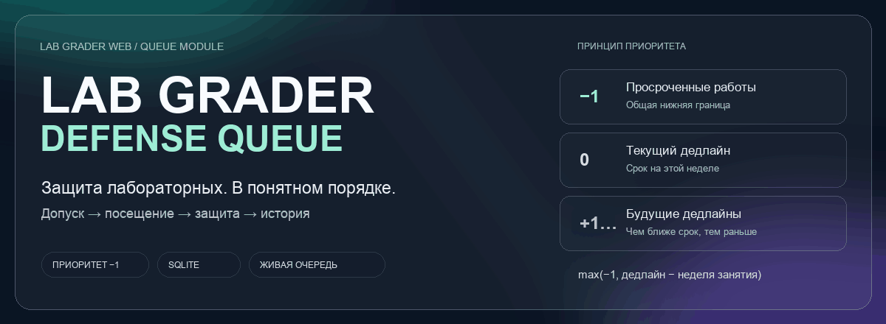

<p align="center">
  <picture>
    <source media="(prefers-reduced-motion: reduce)" srcset="docs/assets/readme/hero.svg">
    
  </picture>
</p>

<div align="center">

# Lab Grader · Defense Queue

**Проверка работ, запись на занятие и порядок защиты в одном сервисе.**

<p>
  <a href="docs/queue/RUNBOOK.md">Запустить демо</a> ·
  <a href="research/queue-study/README.md">Исследование</a> ·
  <a href="docs/adr/README.md">Архитектурные решения</a> ·
  <a href="docs/hackathon/lab-grader-queue/README.md">ADR по шаблону задания</a> ·
  <a href="docs/queue/README.md">Устройство очереди</a>
</p>


</div>

<br>

## От проверки работы до защиты

В основе проекта существующий **Lab Grader Web**: студент указывает GitHub-аккаунт, сервис проверяет репозиторий и CI и сохраняет результат в Google-таблице курса. Модуль очереди добавляет список на занятие, подтверждение посещения и инструменты преподавателя.

После допуска студент появляется в постоянной очереди своей группы. Он выбирает, придёт ли на ближайшую пару. В начале занятия сервер фиксирует состав; преподаватель вызывает студентов, отмечает результат и видит историю. SQLite сохраняет эти данные при перезапуске.

> [!IMPORTANT]
> Очередь организует порядок защиты. Модуль очереди не изменяет оценки в Google-таблице.

<table>
<tr>
<td width="33%" valign="top">
<strong>01 / Студент</strong><br><br>
Список ближайшей пары, предварительная позиция во время проверки, кнопки «Приду / не приду». Повторное открытие списка не требует запуска автотестов.<br><br>
<a href="docs/queue/RUNBOOK.md#студент">Сценарий студента →</a>
</td>
<td width="33%" valign="top">
<strong>02 / Преподаватель</strong><br><br>
Весь состав занятия, все вызванные студенты и следующий, результаты защиты, повторные попытки в конце, статистика и история.<br><br>
<a href="docs/queue/RUNBOOK.md#преподаватель">Панель преподавателя →</a>
</td>
<td width="33%" valign="top">
<strong>03 / Расписание</strong><br><br>
Ручные занятия, источник ГУАП и импорт другого вуза. Перенос сохраняет занятие и ответы студентов; ручные правки важнее обновления источника.<br><br>
<a href="docs/queue/RUNBOOK.md#расписание-и-другие-вузы">Расписание и переносы →</a>
</td>
</tr>
</table>

## Порядок с нижней границей −1

```text
Приоритет = max(−1, неделя дедлайна − неделя занятия)

    −1                    0                   +1, +2, …
Просроченные         Текущий дедлайн       Будущие дедлайны
    └─────────────────────┴───────────────────────┘
                    Раньше → позже
```

При равных приоритетах приложение сохраняет порядок допуска. Повторная попытка после «Не сдал» попадает в общий конец. Если срок получить не удалось и ручного значения нет, сервер включает случайный режим. Явное отсутствие дедлайна учитывается отдельно.

[Правила и исключения](docs/adr/0001-priority-policy.md) · [Сравнение моделей](research/queue-study/README.md)

## Посмотреть за два терминала

> [!TIP]
> Демо использует настоящие API очереди и SQLite с вымышленными студентами. Docker, Google service account и GitHub-токен для него не нужны.

Нужны **uv**, **Python 3.12** и **Node.js 20+**. Команды выполняются из корня репозитория.

**Терминал 1 · backend**

```bash
uv venv --python 3.12 --allow-existing .venv
uv pip install --python .venv/bin/python -r requirements-dev.txt
.venv/bin/python scripts/run_queue_demo.py
```

**Терминал 2 · frontend**

```bash
cd frontend/courses-front
npm ci --legacy-peer-deps
VITE_API_BASE_URL=http://localhost:8000 npm run dev -- --host localhost --port 5173 --strictPort
```

| Экран | Адрес | Данные для демо |
|---|---|---|
| Вход преподавателя | <http://localhost:5173/admin> | `demo` / `demo123` |
| Очередь преподавателя | <http://localhost:5173/admin/courses/queue-demo/queue> | Открыть после входа |
| Страница студента | <http://localhost:5173/course/queue-demo/group/DEMO-01/lab/1> | Иванов / Иван / Иванович / `demo-ivan` |

У студента нужно открыть вкладку **«Список на занятие»**. Допуски в демо уже подготовлены. Новый запуск создаёт отдельный набор данных.

<details>
<summary><strong>Настроить настоящий курс вместо демо</strong></summary>

Для работы с реальными репозиториями и Google-таблицей нужны собственные ключи и конфигурация курса. Порядок настройки описан в [локальной разработке](docs/DEVELOPMENT.md), включение очереди и её постоянной базы в [инструкции очереди](docs/queue/RUNBOOK.md).

Docker остаётся дополнительным способом запуска. Для него подготовлены `backend.Dockerfile` и `docker-compose.example.yaml` с постоянным томом SQLite.

</details>

## Исследование → решение → реализация

| Материал | Что внутри | Открыть |
|---|---|---|
| **Вычислительное исследование** | Восемь правил очереди, три финалиста, распределения баллов, чувствительность и экзаменационные сценарии | [Статья и графики](research/queue-study/README.md) |
| **ADR-0001** | Почему команда выбрала нижнюю границу −1 и как приложение упорядочивает работы | [Приоритет](docs/adr/0001-priority-policy.md) |
| **ADR-0002** | SQLite, транзакции, ограничения и история попыток | [Хранение](docs/adr/0002-sqlite-storage.md) |
| **ADR-0003** | Разные вузы, источники расписания и ручные изменения | [Расписание](docs/adr/0003-schedule-adapters.md) |
| **Модуль очереди** | Сущности, состояния, API и инструкция запуска | [Документация](docs/queue/README.md) |

Исследование использует синтетических студентов. Его баллы и вероятности описывают модель; фактические результаты студентов приложение не прогнозирует.

## Карта проекта

```text
grading/defense_queue/        Правила, SQLite, допуск, расписание, сверка
main.py                      HTTP API и подключение к проверке работ
frontend/courses-front/      Интерфейсы студента и преподавателя
research/queue-study/        Модели, исходные результаты и графики
docs/adr/                    Архитектурные решения
docs/queue/                  Устройство очереди, API и запуск
scripts/run_queue_demo.py    Изолированная локальная демонстрация
```

<details>
<summary><strong>Проверки и техническая документация</strong></summary>

```bash
python3 -m unittest discover -s tests -p 'test_defense_queue*.py'
python3 docs/queue/test_schema.py
cd frontend/courses-front
npm test
npm run build
```

| Документ | Назначение |
|---|---|
| [DEVELOPMENT](docs/DEVELOPMENT.md) | Локальное окружение и собственные интеграции |
| [RUNBOOK](docs/queue/RUNBOOK.md) | Демо, настройка очереди, хранение и восстановление |
| [Аудит и готовность](docs/queue/AUDIT-2026-11-07.md) | Проверки, исправления и расхождения с требованиями |
| [API](docs/queue/API.md) | Маршруты и форматы запросов очереди |
| [COURSE CONFIG](docs/COURSE_CONFIG.md) | Конфигурация курса |
| [DEPLOYMENT](docs/DEPLOYMENT.md) | Развёртывание сервиса |
| [PROJECT DESCRIPTION](docs/PROJECT_DESCRIPTION.md) | Возможности исходного сервиса |
| [CLAUDE.md](CLAUDE.md) | Соглашения проекта |

</details>

---

<div align="center">

**Lab Grader Web · модуль очереди защиты**<br>
[Демо и запуск](docs/queue/RUNBOOK.md) · [Исследование](research/queue-study/README.md) · [ADR](docs/adr/README.md) · [Лицензия MIT](LICENSE)

</div>
