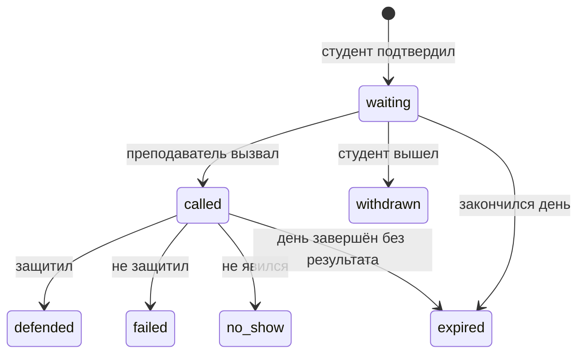

# Проект хранения очереди

[SQLite ADR](../adr/0002-sqlite-storage.md) · [Алгоритм](../adr/0001-priority-policy.md) · [Расписание](../adr/0003-schedule-adapters.md) · [Термины](GLOSSARY.md)

Здесь лежат исполняемая схема и проверки проекта БД. Миграция к работающему приложению не подключена. Реальных данных в этой папке нет.

## Сущности и ключи

| Сущность | Идентификатор | Важные поля и ограничения |
|---|---|---|
| Курс | `course_id` из `courses/index.yaml` | Настройки очереди являются проверенной проекцией конфигурации курса |
| Группа | `(course_id, group_id)` | Одинаковый номер на другом курсе не связывает очереди |
| Студент | `student_id` | Имя не уникально; GitHub уникален без учёта регистра при наличии |
| Участие в курсе | `(course_id, student_id)` | Группа и стабильный ключ источника; строки Sheets не используются как постоянные ключи |
| Занятие | `session_id` | Устойчивая связь `source_key`, группа, преподаватель, местная дата, UTC-границы |
| Исключение расписания | `override_id` | Отмена дня или добавление интервала, автор, ревизия |
| Попытка | `entry_id` | Одна работа, один студент, одно занятие, приоритет, тип записи, снимок допуска и статусы |
| Событие | `event_id` | Кто, когда и почему изменил запись или занятие; только добавление |

Не все связи защищаются FK. Например, принадлежность студента текущей группе проверяется при записи и может позже измениться; история сохраняет старую группу. Порядок работ и допустимость очередной защиты проверяются по конфигурации и прочитанному допуску. SQL не распознаёт `v`, `vv`, `x` или `?` и не читает внешнюю таблицу.

## Статусы записи



Повторное вступление после `defended`, `failed` или `no_show` создаёт новую строку, если запись ещё открыта. Прежнюю строку не возвращаем в `waiting`. Для случайно оставшегося `called` на конец дня событие `expired` должно содержать причину и отображаться преподавателю: оно не подменяет результат защиты.

Список допустимых значений ограничен DDL. Разрешённые переходы, права участников и согласованность времени контролируются сервисом в транзакции. Для административного исправления результата нужен отдельный метод с причиной, а не произвольный `PATCH status`.

## Пример с пересечением

У группы G1 занятие в 10:00 у преподавателя T1, у G2 занятие в 10:00 у T2. Это две сессии и два независимых списка ожидающих. Если T1 одновременно назначен и на вторую сессию, он может выбирать список, но уникальный индекс не даст одновременно вызвать по студенту из обоих списков. Студент не может занимать два активных места одного курса.

Отмена G1 не закрывает G2. Добавление ещё одного приёма G1 не переписывает первоначальный `session_id`. Перенос через другую дату сохраняет исходную историю; новой дате соответствует новая сессия. Студент подтверждает новую запись сам после открытия окна.

## Какие операции должны быть атомарны

| Операция | Проверки до фиксации | Изменения в одной транзакции |
|---|---|---|
| Записать | Окно открыто, группа подходит, первая работа допущена, нет активной записи, `request_key` корректен | Новая попытка + событие |
| Вызвать | У преподавателя нет вызванного, ожидающий ещё активен | `waiting → called`, `called_at`, `version + 1` + событие |
| Результат | Преподаватель имеет право, запись всё ещё `called`, совпала версия | Терминальный статус, `closed_at`, `version + 1` + событие |
| Выйти | Своя ожидающая запись | `withdrawn` + событие |
| Истечение дня | `expires_at <= now`, статус активный | `expired` для оставшихся + события |
| Закрыть запись | Право преподавателя | Изменение состояния занятия + событие без удаления ожидающих |
| Обновить сроки | Проверенная новая конфигурация | Ожидающие приоритеты + событие с прежними и новыми значениями |

SQL-транзакция короткая, внешние API в ней не вызываются. При фиксации повторно проверяется состояние, которое могло измениться после подготовки данных. Ошибка уникального индекса переводится в понятный конфликт, а не бесконечный повтор.

## Почему нет отдельных таблиц «баллы» и «очереди»

Оценки принадлежат существующему процессу проверки и преподавателю. Очередь хранит лишь факт своей попытки и снимок прочитанного допуска. Из этих снимков нельзя собирать собственный официальный журнал баллов. Неизвестный формат ячейки означает, что автоматический допуск не подтверждён: парсер должен объяснить причину, а не принять любой текст с буквой `v`.

Для одного занятия уже есть `sessions`; добавление сущности `queues` с тем же ключом не даёт отдельного смысла. Дальнейшее обслуживание до конца дня относится к той же сессии, а не требует второй очереди на «после пары».

## Проверка без приложения

```bash
python3 docs/queue/test_schema.py
```

Тесты создают временные базы и удаляют их после выполнения. Стандартной библиотеки Python достаточно; необходима сборка SQLite с JSON-функциями. Реальная версия SQLite и результаты проверок записаны в [отчёте проверки исследования](../../research/queue-study/validation.json).

При интеграции перенести DDL в версионированную миграцию, добавить соединения с нужными PRAGMA, сервис операций и API в принятых проектом местах (`grading/` и `main.py`). Обработчики, авторизация, интерфейс, реальный адаптер расписания и постоянный том в этот пакет не входят.
