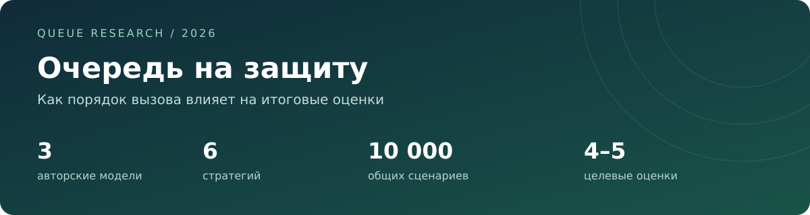
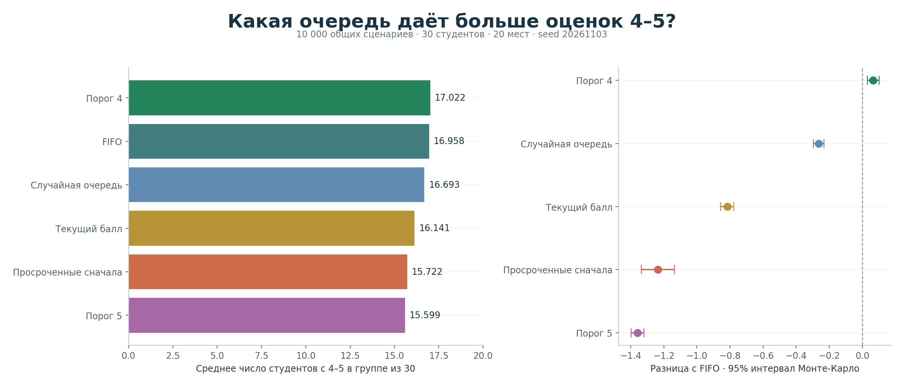
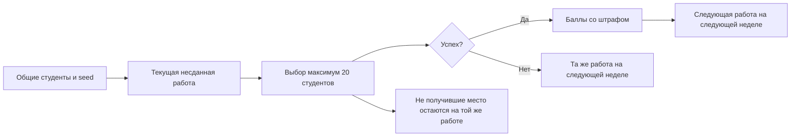
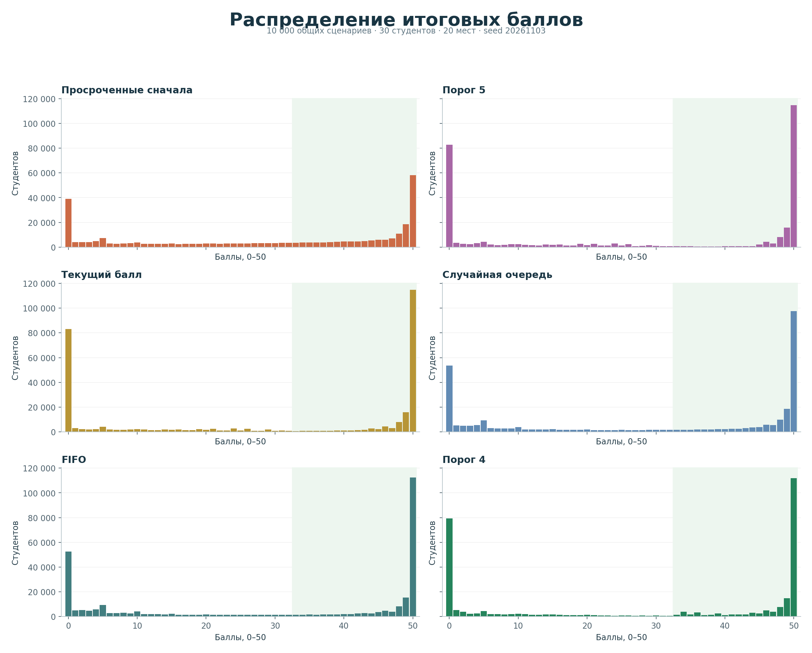
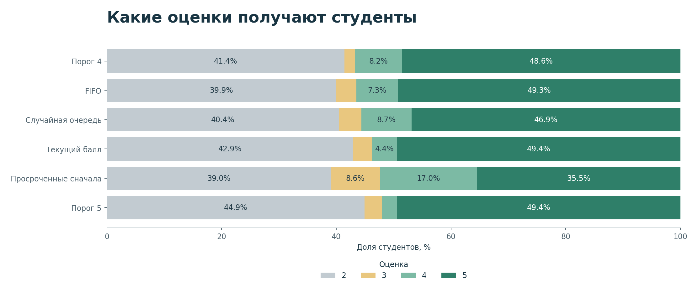
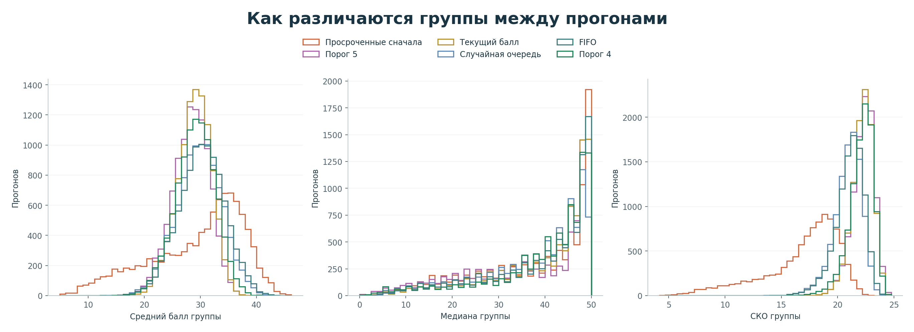

<div align="center">



**3 авторские модели · 6 стратегий · 60 000 сравнительных прогонов · 1 800 000 результатов студентов**

[Результат](#главный-результат) · [Стратегии](#что-сравниваем) · [Графики](#графики) · [Данные](#сохранённые-данные) · [Повторить](#как-повторить)

</div>

> [!NOTE]
> Это отдельное исследование очередей. Оно не меняет работающий сервис, оценки,
> таблицы или готовую структуру приоритетной очереди в `grading/`.

## Главный результат

**В заданной модели вариант «Порог 4» дал больше всего студентов с оценками 4–5,
но преимущество над обычной FIFO невелико: +0,0648 человека на группу из 30.**

Общий seed — **20261103**. Каждая стратегия проверена на одних и тех же
10 000 сценариях. При подсчёте ранга используется только число оценок 4–5,
а не средний балл и не отдельное число пятёрок.

| Место | Стратегия | С оценкой 4–5 на группу | Доля 4–5 | Средний балл / 50 | Разница с FIFO |
|:---:|---|---:|---:|---:|---:|
| 1 | **Порог 4** | **17,0224** | **56,7413%** | 29,0778 | +0,0648 |
| 2 | FIFO | 16,9576 | 56,5253% | **30,2242** | — |
| 3 | Случайная очередь | 16,6928 | 55,6427% | 29,7296 | −0,2648 |
| 4 | Текущий балл | 16,1410 | 53,8033% | 28,9051 | −0,8166 |
| 5 | Просроченные сначала | 15,7218 | 52,4060% | 29,3427 | −1,2358 |
| 6 | Порог 5 | 15,5991 | 51,9970% | 28,2966 | −1,3585 |



Для «Порога 4» приблизительный 95%-й интервал Монте-Карло разницы с FIFO:
**от +0,0294 до +0,1002 человека на группу**. Это около **+0,216 процентного
пункта** доли оценок 4–5. Интервал описывает случайность прогонов при заданных
предположениях, а не точность прогноза для реальных студентов.

> [!IMPORTANT]
> Лучший результат среди этих шести кандидатов не доказывает оптимальность
> алгоритма. FIFO имеет более высокий средний балл и меньшую долю двоек, чем
> «Порог 4». Выбор целевого критерия действительно меняет предпочтения.

## Что сравниваем

| Код | Правило выбора | Происхождение |
|---|---|---|
| `deadline` | Самый ранний дедлайн первым; при равенстве случайный выбор | А. М. Кутыев |
| `chance_5` | Сначала потенциально достижимые 45 баллов, затем больший текущий балл | Н. А. Щепоткин, основной режим |
| `score` | Больший текущий балл первым | Н. А. Щепоткин, альтернативный режим |
| `random` | Равновероятный случайный порядок каждую неделю | Е. И. Волжанин; также режим `fair` у Н. А. Щепоткина |
| `fifo` | Кто дольше ждёт; после попытки вернуться в конец | Добавленная базовая стратегия |
| `chance_4` | Сначала ещё не набравшие 33, но потенциально способные их набрать; затем больший текущий балл | Добавленный кандидат под цель «больше 4–5» |

В `chance_5` достижимость оценивается по верхней границе:
`текущий балл + 5 × число оставшихся работ`. Она **не учитывает будущие
штрафы, оставшееся время и вероятность успеха**. Название режима не означает
вычисленную вероятность получения пятёрки.

В `chance_4` сначала выбираются студенты, для которых `балл < 33 ≤ верхняя
граница`, затем уже набравшие 33, затем остальные. Внутри категорий — текущий
балл по убыванию, затем случайное разрешение равенства.

У всех стратегий, кроме FIFO, окончательные равенства разрешаются одинаковыми
заранее подготовленными случайными числами. У FIFO сохраняется порядок
ожидания; после успеха или неудачи студент возвращается в конец. Очередь
`deadline` здесь соответствует авторской модели Кутыева: её равенства
случайные, поэтому она отличается от варианта с FIFO при равенстве приоритетов.

## Общий контракт модели

| Параметр | Значение |
|---|---|
| Группа | 30 студентов |
| Работы | 10 последовательно сдаваемых лабораторных |
| Семестр | 30 недель, один день приёма в неделю |
| Вместимость | 20 студентов в неделю; параметр CLI `--capacity` |
| Баллы | До 5 за работу, до 50 за семестр |
| Дедлайны | `3 × номер работы − 1`: 2, 5, 8, 11, 14, 17, 20, 23, 26, 29 |
| Вероятность успеха | `p ~ Uniform(0,1)` один раз на студента на весь семестр |
| Попытки | Одна в неделю, без общего лимита |
| Просрочка | −1 за каждую неделю; в неделю дедлайна штрафа нет |
| Оценки | 2: 0–24; 3: 25–32; 4: 33–44; 5: 45–50 |

Все начинают пытаться сдать ЛР1 на первой неделе. Следующая работа доступна
только после успеха предыдущей, не раньше следующей недели. Работа с нулевой
стоимостью тоже должна быть сдана, иначе переход дальше невозможен.

Формула стоимости успешной сдачи:

```text
max(0, 5 − max(0, неделя сдачи − дедлайн))
```

Непопадание в 20 мест считается неуспешной возможностью сдачи, но не реальной
попыткой у преподавателя. В данных отдельно хранятся `failed_attempts` и
`capacity_misses`; их сумма — `failed_opportunities`. Оба случая сохраняют
текущую работу, ничего не засчитывают и не ограничивают будущие попытки.



## Почему нужны два вида запуска

**Оригинальные запуски** сохраняют авторский код, seed и результаты. Они нужны
для проверки того, что именно прислали участники. Исходники двух файлов
скопированы побайтово, третий перенесён из сообщения Гоши. Контрольные суммы
находятся в [originals/SHA256.json](originals/SHA256.json).

**Общее сравнение** переносит правила выбора в один небольшой движок.
Это сравнение идей на одинаковых входных данных, а не обещание побайтово
воспроизвести случайные траектории оригиналов. В оригиналах используется
NumPy Generator; в общем движке — `random.Random` стандартной библиотеки.

В каждом общем прогоне заранее создаются вероятности, исходы для каждой пары
«студент–неделя» и отдельные случайные числа разрешения равенств. Затем
один сценарий проигрывается всеми стратегиями. Алгоритм очереди не получает
скрытую вероятность `p`. Поэтому выбор очереди не изменяет случайные броски
других студентов просто из-за другого расхода генератора.

<details>
<summary><strong>Аудит трёх авторских моделей</strong></summary>

| Автор | Исходник | Seed | СКО в оригинале | Что учтено |
|---|---|---:|---|---|
| А. М. Кутыев | [Python](originals/а-м-кутыев.py) | 42 + номер прогона | Выборочное, `ddof=1` | В общей модели приведено к `ddof=0`; равенства приоритетов сохранены случайными |
| Н. А. Щепоткин | [Python](originals/н-а-щепоткин.py) | 20260427 + номер прогона | Генеральное, `ddof=0` | Основной режим нацелен на 5; дополнительно сравнены доступные `score` и `fair` |
| Е. И. Волжанин | [Python](originals/е-и-волжанин.py) | 42, один генератор на все прогоны | Генеральное, `ddof=0` | Случайный порядок сохранён; генераторы в сравнении разделены |

У Кутыева `DEADLINES` вычисляются из глобальной конфигурации: замена одного
только аргумента `config['n_labs']` не пересчитает дедлайны. В общем движке
дедлайн вычисляется из номера работы. Экспорт с заданными порогами оценок
явно ограничен десятью работами по пять баллов.

У оригиналов случайный выбор и результаты попыток берутся из одного потока
генератора. Это не делает каждый отдельный запуск ошибочным, но мешает
строго парному сравнению стратегий. В общем движке потоки разделены.

Оригинал Щепоткина начинает симуляцию при импорте. Его нужно запускать как
отдельный процесс в отдельном каталоге, а не импортировать в веб-сервер.

Все три оригинала отработали по 10 000 прогонов. Распределения и статистики
сверены с сырыми результатами:
[машиночитаемый протокол](results/original-verification.json).

| Оригинальный запуск | 4–5 на группу | Средний балл | Почему это не сравнительный рейтинг |
|---|---:|---:|---|
| Кутыев | 15,8121 | 29,4231 | Свой генератор и сценарии |
| Щепоткин, `chance_5` | 15,6419 | 28,3462 | Другой seed |
| Волжанин | 16,7586 | 29,7874 | Непрерывный поток генератора |

</details>

## Графики

### Баллы 0–50

Один столбик на один целочисленный балл. На каждой панели по 300 000 результатов;
шкалы одинаковые, зелёным отмечена область 33–50 баллов.



### Оценки 2–5



### Среднее, медиана и СКО отдельных групп



В [assets](assets) каждый график есть в PNG и SVG. Графики строятся из
сохранённых данных: заново считать 10 000 семестров не требуется.

## Сохранённые данные

Основной каталог: [results/paired-20261103](results/paired-20261103).

| Файл | Содержимое |
|---|---|
| [summary.json](results/paired-20261103/summary.json) | Конфигурация, seed, версия Python, SHA-256 движка, общие статистики, парные разницы и интервалы |
| [per_run.csv](results/paired-20261103/per_run.csv) | 60 000 строк: среднее, медиана, СКО, оценки и число неуспешных возможностей для каждого прогона каждой стратегии |
| `<стратегия>/histogram.csv` | Все 51 значение от 0 до 50 и суммарное число студентов с каждым баллом |
| `<стратегия>/students.csv.gz` | Все 300 000 результатов: seed, номер студента, p, балл, оценка, число сданных работ |
| [environment.json](results/environment.json) | Версии зависимостей оригинальных запусков и графиков |

Оригинальные результаты лежат отдельно:
[Кутыев](results/original-kutyev), [Щепоткин](results/original-shchepotkin),
[Волжанин](results/original-volzhanin). Сохранены CSV, JSON, сырые массивы
и графики авторов, если они создавались исходником.

В общей модели **СКО генеральное (`ddof=0`)**. Сохранены оба требуемых варианта:

1. `mean_of_runs` — посчитать статистики каждой группы, затем усреднить их.
2. `pooled` — посчитать статистики всех 300 000 студентов вместе.

Средние двух вариантов совпадают при одинаковом размере групп; медианы и
СКО обычно различаются. Это разные измерения, а не ошибка округления.

<details>
<summary><strong>Как открыть сжатые сырые результаты</strong></summary>

`students.csv.gz` — обычный CSV, сжатый gzip; его можно распаковать архиватором
или прочитать напрямую:

```python
import csv
import gzip

with gzip.open("research/results/paired-20261103/fifo/students.csv.gz", "rt") as file:
    for row in csv.DictReader(file):
        print(row)
        break
```

</details>

## Как повторить

Команды выполняются из корня репозитория. Основная модель и её тесты требуют
только Python 3.11+. Все приведённые прогоны проверены; версия интерпретатора
общего эксперимента записана в `summary.json`.

```bash
# Тесты модели
python3 -m unittest research.test_experiment -v

# Новая серия: выбирай новый каталог, существующие результаты не перезаписываются
python3 -m research.experiment --runs 10000 --seed 20261103 \
    --capacity 20 --output research/results/my-experiment

# Независимая сверка сводок по сырым результатам
python3 -m research.verify research/results/my-experiment
```

Для оригиналов и графиков нужны NumPy, pandas и matplotlib; проверенные версии
зафиксированы в [requirements.txt](requirements.txt), использовался Python 3.12.14.

```bash
python3.12 -m venv .venv-research
source .venv-research/bin/activate
python -m pip install -r research/requirements.txt

# Построить графики без повторного моделирования
python -m research.plot research/results/paired-20261103 research/assets

# Проверить оригинальные результаты
python -m research.audit_originals
```

Для повторения оригинала сначала создай отдельный рабочий каталог, перейди
в него и запусти нужный исходник по абсолютному пути. Для работы без окон
установи `MPLBACKEND=Agg`. Выходные каталоги оригиналов относительные;
не запускай их в каталоге уже сохранённого эксперимента.

## Ограничения и следующий эксперимент

- Здесь нет подготовки работы, пропусков занятий, отчётов, экзамена и разной
  длительности защиты. У студента только одна постоянная вероятность успеха.
- Условие «больше 4–5» не равнозначно уменьшению числа двоек или увеличению
  среднего балла. Различие видно в распределении оценок.
- В этой модели штраф зависит от недели успешной защиты. В коде реального
  сервиса он привязан к дате успешных автоматических тестов. Модель не является
  прямой имитацией нынешних правил курса.
- Небольшое преимущество «Порога 4» проверено только для заданного набора
  параметров. Следующий полезный шаг — повторить сравнение при вместимости
  10, 15, 25 и 30, с новыми seed и обсудить допустимость приоритета по баллам.

Исследование отвечает на вопрос о поведении этих стратегий при оговорённых
предположениях. Решение о правилах настоящей очереди принимается отдельно.
