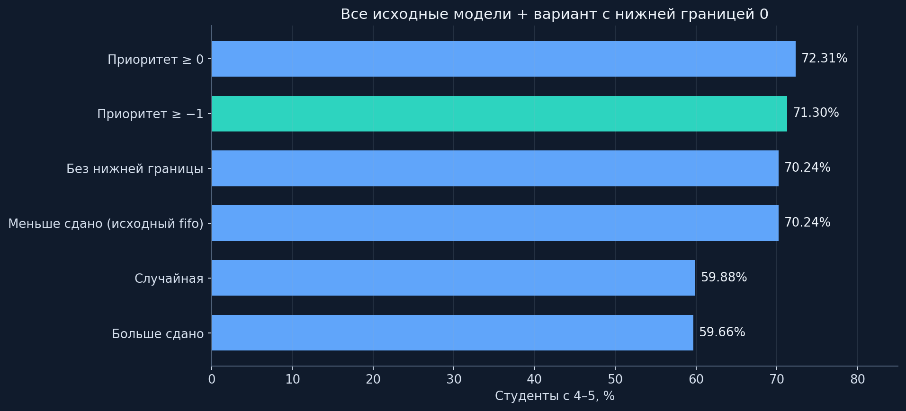
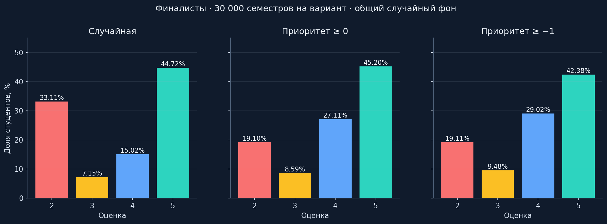
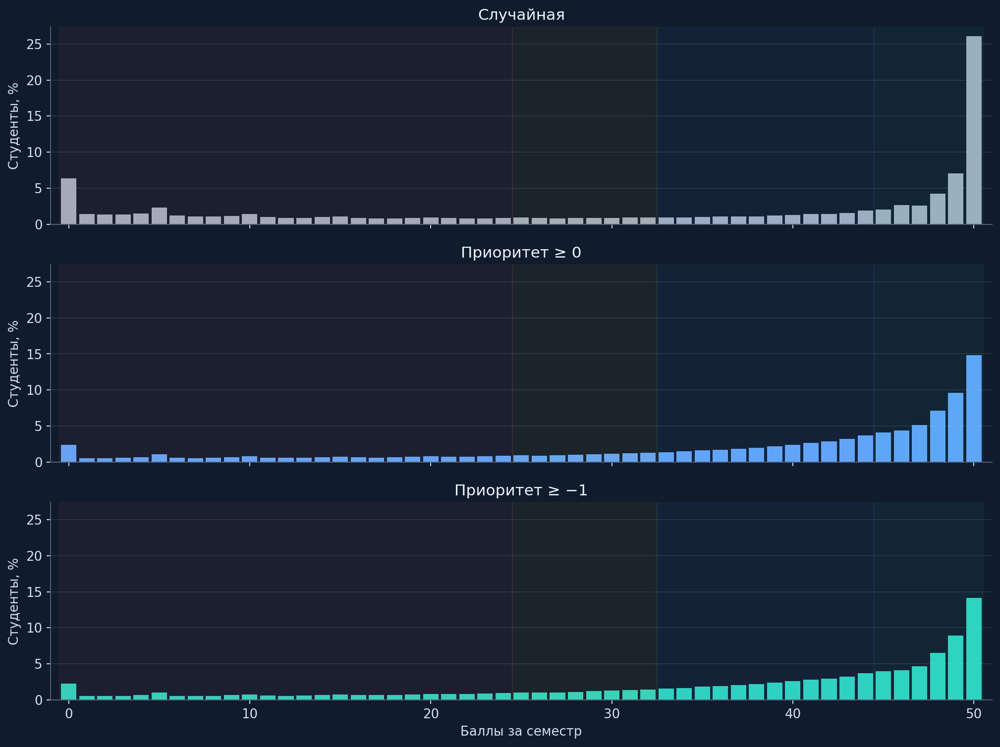
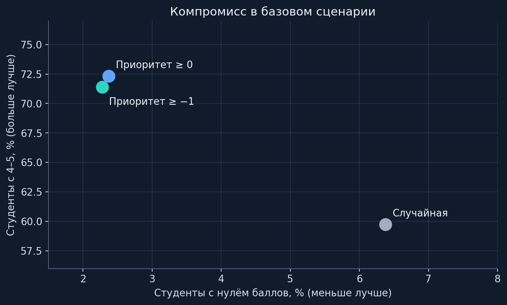
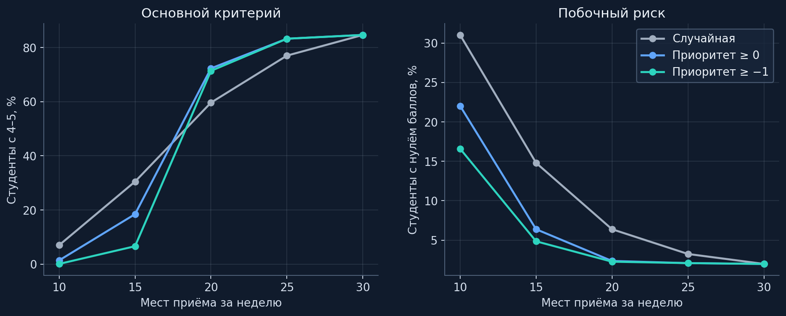
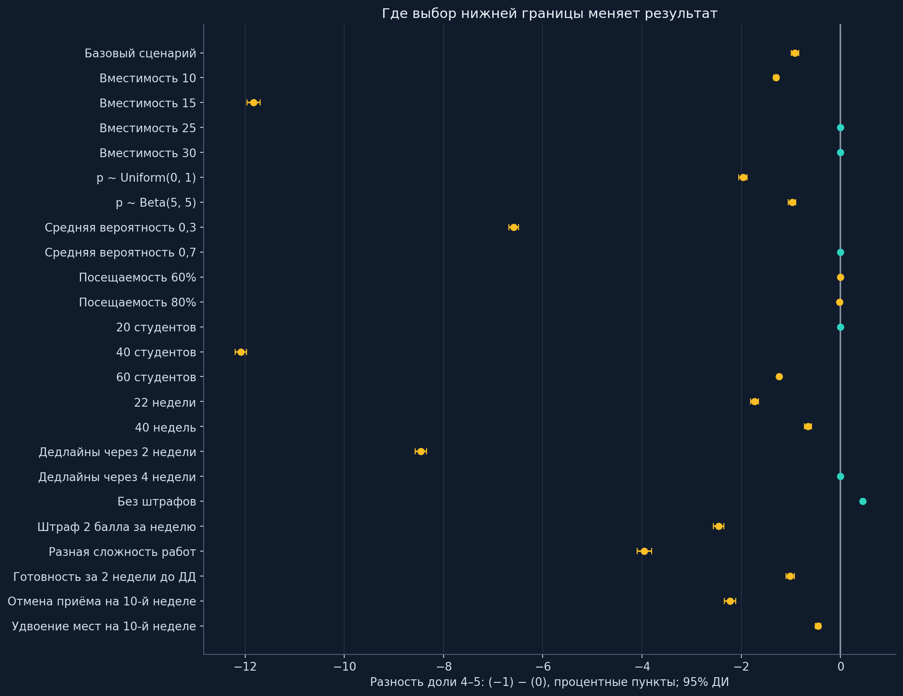

<div align="center">

# Очередь, дедлайны и цена приоритета

**Исследование алгоритмов записи на защиту лабораторных**

`30 студентов` · `10 работ` · `30 недель` · `20 мест` · `seed 42`

[Результаты](#три-финалиста) · [Чувствительность](#когда-меняются-условия) · [Запуск](#воспроизведение) · [ADR](../../docs/adr/README.md)

</div>

> **Решение команды:** нижняя граница приоритета −1. **Результат эксперимента:** по доле оценок 4–5 в базовых условиях лучше граница 0. Выбор −1 сохраняет преимущество просроченных работ, но не является максимумом выбранного KPI. Разницу ниже показываем численно.

## Задача и критерий

На занятии преподаватель успевает принять ограниченное число защит. Порядок влияет на то, кто попадёт на приём до дедлайна и сколько баллов потеряет при задержке. Сравниваем правила распределения одинакового ресурса; пропуск из-за очереди не считается успешной защитой и не открывает следующую работу.

Основной показатель: **доля студентов с итоговыми оценками 4 или 5**, то есть с 33–50 баллами. Отдельно считаем долю 3–5, нули, средние баллы, завершённые работы и пропуски из-за очереди. Переключать главный показатель после получения результата нельзя: победа по 3–5 не доказывает победу по 4–5.

Это вычислительный эксперимент на синтетических студентах. Наблюдений реальных защит и причинной проверки на учебных группах нет. Баллы здесь принадлежат модели; функция очереди в приложении не выставляет оценки и не меняет ячейки Google Sheets.

## Что получили от команды

В [source/](source/) сохранены байтовые копии Python-файлов AllModels. Входные данные, переписка, реальные студенты и секреты в исследование не включены. [Контрольные суммы](original_source_hashes.json) позволяют проверить происхождение кода. Исходники написаны командой; расчётный стенд, проверка и оформление исследования добавлены отдельно.

| Исходная модель | Реальное правило |
|---|---|
| `random` | Новый случайный порядок активных студентов каждую неделю |
| `priority` | Меньше `deadline − week` → раньше |
| `priority_clamped` | `max(−1, deadline − week)`; равные приоритеты случайны |
| `most_passed` | Больше завершённых работ → раньше |
| `fifo` | Меньше завершённых работ → раньше; это **не FIFO по времени записи** |
| Дополнительный вариант `priority_clamped_zero` | Тот же исходный класс с нижней границей 0 |

При общих возрастающих дедлайнах `priority` и исходный `fifo` задают одинаковый порядок: обе сортируют по номеру текущей работы. Их результаты совпали побитно на всех 10 000 прогонах. Это две реализации одного правила в данных условиях, а не два независимых подтверждения.

В комментариях AllModels есть устаревшие формулировки: распределение названо Uniform, хотя код использует Normal; описание границы −1 говорит о трёх неделях; −10 ошибочно названо эквивалентом отсутствия границы. В течение 30 недель возможна просрочка первой работы на 28 недель. Копии не исправлялись: расчёты опираются на исполняемый код, а расхождения перечислены здесь.

## Условия базового семестра

| Параметр | Значение |
|---|---|
| Размер группы / число работ | 30 / 10 |
| Период | 30 недель, один приём в неделю |
| Вместимость | **20** студентов за приём; 15 проверяем отдельно как жёсткий сценарий |
| Вероятность успешной защиты | Для каждого студента один раз: `clip(Normal(0.5, 0.15), 0.05, 0.95)` |
| Дедлайн работы k | `3k − 1`: недели 2, 5, 8, …, 29 |
| Баллы за защищённую работу | `max(0, 5 − max(0, неделя_защиты − дедлайн))` |
| Последовательность | Сначала ЛР1; следующая доступна после защиты предыдущей |
| Попытки | Не больше одной за неделю, включая неудачную; выбывшие из-за вместимости ждут следующую неделю |
| Готовность | В базовом сценарии текущая работа доступна с первой недели; тестирование и подготовка отдельно не моделируются |
| Оценки | 2: 0–24; 3: 25–32; 4: 33–44; 5: 45–50 |

Все 10 работ дают максимум 50 баллов. В день дедлайна штрафа нет. Нулевая стоимость старой работы не отменяет необходимость её защитить, чтобы перейти дальше. Бонус `EXAM_BONUS=5` из AllModels сохранён лишь как дополнительная гипотетическая колонка в исходной сводке; он не участвует в основных оценках, графиках и выборе алгоритма.

## Как устроен эксперимент

**Этап A: воспроизведение AllModels.** Шесть вариантов × 10 000 семестров = 60 000 семестров. Исходная последовательность seed: 42…10041. Сохранены исходные графики, баллы, статистика каждого семестра и сводка. Класс с границей 0 запускается отдельной обёрткой без правки AllModels. Одинаковые seed в исходном коде не обеспечивают одинаковые случайные события для одного студента после расхождения очередей: меняется число и порядок обращений к генератору.

**Этап B: парное сравнение финалистов.** 24 сценария по 10 000 семестров на вариант. Базовый сценарий дополнительно повторён с seed 1042 и 2042: всего 780 000 семестров для трёх финалистов. Начальные вероятности, посещаемость, случайные ключи равных приоритетов и исходы возможных попыток фиксированы для каждого студента и недели и совпадают между тремя вариантами. Алгоритм меняет только допуск к попытке. Векторизация проверена независимой реализацией с обычными циклами.

Сравниваем разность показателей **внутри одного семестра**, затем усредняем. 95% доверительный интервал: `mean(delta) ± 1.96 × std(delta, ddof=1) / sqrt(n_runs)`. Единица независимого наблюдения здесь семестр, поскольку студенты одной группы конкурируют друг с другом. Это интервал ошибки Монте-Карло в заданной модели; он не учитывает ошибку её описания реальности. Для серии сценариев интервалы описательные, без поправки на множественные сравнения. Основное сравнение заранее задано задачей: −1 против 0 и случайной очереди по доле 4–5.

Протокол с точными параметрами и версиями среды: [protocol.json](results/finalists/protocol.json). Никакие сценарии из итоговой таблицы не исключены по результату.

## Все модели: исходное исполнение



| Правило | 4–5 | 3–5 | Ноль баллов | Средний балл |
|---|---:|---:|---:|---:|
| Приоритет ≥ 0 | 72.31% | 80.90% | 2.37% | 37.19 |
| Приоритет ≥ −1 | 71.30% | 80.90% | 2.31% | 36.87 |
| Меньше сдано (исходный fifo) | 70.24% | 80.50% | 2.26% | 36.62 |
| Без нижней границы | 70.24% | 80.50% | 2.26% | 36.62 |
| Случайная | 59.88% | 67.01% | 6.38% | 32.83 |
| Больше сдано | 59.66% | 61.95% | 23.91% | 31.06 |

Большое число пятёрок само по себе может скрывать потери остальных студентов: `most_passed` оставляет большой хвост нулевых результатов. У неограниченного приоритета противоположный риск: очень старые работы продолжают выигрывать у более близких к достижению высокой оценки. Нижняя граница объединяет сильно просроченные работы в один класс и ограничивает этот эффект. Это объяснение механизма; для конкретных процентов основанием служат сохранённые результаты.

## Три финалиста

Для этой таблицы объединены **три seed × 10 000 семестров**, по 900 000 синтетических студентов на алгоритм. Их результаты не смешиваются с этапом A.



| Алгоритм | 4–5 | 3–5 | Ноль баллов | Среднее | Медиана всех баллов | СКО всех баллов |
|---|---:|---:|---:|---:|---:|---:|
| Случайная | 59.74% | 66.89% | 6.38% | 32.800 | 41.0 | 18.331 |
| Приоритет ≥ 0 | 72.31% | 80.90% | 2.37% | 37.197 | 43.0 | 14.378 |
| Приоритет ≥ −1 | 71.40% | 80.89% | 2.27% | 36.872 | 42.0 | 14.180 |

**Граница 0 выигрывает по основному критерию.** У −1 меньше нулей, но большее число студентов с 4–5 это не обеспечивает. Предпочтение просроченным работам и максимизация высоких оценок не тождественны.



### Насколько велика разница

Знак «+» означает, что у −1 показатель выше. Для нулей отрицательная разность желательна; для 4–5 и баллов положительная.

| Сравнение | Показатель | Разность | 95% ДИ |
|---|---|---:|---:|
| −1 против Случайная | Доля 4–5, п. п. | +11.662 | [+11.545; +11.779] |
| −1 против Случайная | Нули, п. п. | -4.101 | [-4.141; -4.060] |
| −1 против Случайная | Средние баллы | +4.072 | [+4.039; +4.105] |
| −1 против Приоритет ≥ 0 | Доля 4–5, п. п. | -0.908 | [-0.951; -0.865] |
| −1 против Приоритет ≥ 0 | Нули, п. п. | -0.095 | [-0.103; -0.088] |
| −1 против Приоритет ≥ 0 | Средние баллы | -0.325 | [-0.334; -0.316] |

Разница между долей 4–5 у 0 и −1 сохраняется на всех трёх базовых seed. Это не единичное удачное перемешивание. Полные парные результаты каждого сценария лежат в [paired_comparisons.csv](results/finalists/paired_comparisons.csv).



### Два способа считать статистику

В предыдущей таблице медиана и СКО рассчитаны по объединённым баллам. Ниже сначала считаем показатель внутри каждой группы, затем усредняем между семестрами. СКО в обоих случаях популяционное (`ddof=0`). Средние баллы совпадают при одинаковом размере групп; средние медиан и СКО совпадать не обязаны.

| Алгоритм | Среднее средних | Среднее медиан | Среднее СКО | Завершено работ на студента | Макс. подряд пропусков в группе, среднее | Отказы / все желаемые попытки |
|---|---:|---:|---:|---:|---:|---:|
| Случайная | 32.800 | 39.807 | 17.941 | 8.955 | 5.218 | 26.07% |
| Приоритет ≥ 0 | 37.197 | 42.355 | 13.348 | 9.174 | 4.656 | 31.82% |
| Приоритет ≥ −1 | 36.872 | 41.858 | 12.974 | 9.167 | 4.745 | 31.93% |

Пропуск здесь означает, что студент пришёл и имел доступную работу, но не получил место. Счётчик подряд обнуляется при обслуживании, отсутствии или недоступности работы; это не календарное время ожидания. Долю отказов нельзя читать как самостоятельную оценку справедливости: алгоритмы меняют число активных студентов и тем самым знаменатель. По одной этой метрике лучшего алгоритма не выбираем.

## Когда меняются условия

Все строки ниже используют seed 42 и 10 000 семестров на вариант. Меняется один фактор относительно базы. В модели сложности коэффициент успешности растёт от 0,8 для первой работы до 1,2 для десятой с ограничением итоговой вероятности диапазоном [0, 1]. В сценарии готовности ЛР k доступна не раньше `max(1, deadline[k] − 2)`. Вместимость 40 на дополнительном приёме всё ещё даёт каждому студенту максимум одну попытку за неделю.

| Условие | Случайная: 4–5 | Граница 0: 4–5 | Граница −1: 4–5 | Разность −1 и 0, п. п. |
|---|---:|---:|---:|---:|
| Базовый сценарий | 59.66% | 72.30% | 71.38% | -0.919 |
| Вместимость 10 | 7.02% | 1.41% | 0.11% | -1.300 |
| Вместимость 15 | 30.49% | 18.47% | 6.64% | -11.831 |
| Вместимость 25 | 77.00% | 83.25% | 83.25% | +0.000 |
| Вместимость 30 | 84.64% | 84.64% | 84.64% | +0.000 |
| p ~ Uniform(0, 1) | 55.89% | 59.83% | 57.86% | -1.966 |
| p ~ Beta(5, 5) | 59.39% | 71.60% | 70.63% | -0.975 |
| Средняя вероятность 0,3 | 20.16% | 9.72% | 3.14% | -6.584 |
| Средняя вероятность 0,7 | 90.29% | 97.79% | 97.79% | +0.000 |
| Посещаемость 60% | 43.60% | 44.41% | 44.41% | -0.002 |
| Посещаемость 80% | 57.58% | 65.45% | 65.43% | -0.020 |
| 20 студентов | 84.60% | 84.60% | 84.60% | +0.000 |
| 40 студентов | 30.54% | 18.32% | 6.24% | -12.087 |
| 60 студентов | 6.96% | 1.35% | 0.11% | -1.240 |
| 22 недели | 49.03% | 50.71% | 48.98% | -1.731 |
| 40 недель | 59.98% | 73.41% | 72.76% | -0.655 |
| Дедлайны через 2 недели | 22.45% | 18.16% | 9.70% | -8.458 |
| Дедлайны через 4 недели | 76.86% | 88.69% | 88.69% | +0.000 |
| Без штрафов | 87.77% | 92.93% | 93.38% | +0.448 |
| Штраф 2 балла за неделю | 52.98% | 61.84% | 59.38% | -2.458 |
| Разная сложность работ | 51.16% | 59.55% | 55.60% | -3.954 |
| Готовность за 2 недели до ДД | 65.80% | 69.67% | 68.65% | -1.016 |
| Отмена приёма на 10-й неделе | 54.98% | 65.21% | 62.98% | -2.226 |
| Удвоение мест на 10-й неделе | 61.96% | 74.90% | 74.45% | -0.451 |



**При 15 местах случайная очередь лучше обеих приоритетных по доле 4–5, а проигрыш −1 варианту 0 существенно больше, чем в мягкой базе.** При дефиците приёма поддержка старых работ расходует попытки, которые могли бы дать высокие результаты другим студентам. Это объяснение направления эффекта, а не измерение индивидуальных причин. Цену решения нельзя скрывать усреднением с более благоприятными условиями. При вместимости на всю группу все три правила дают побитно одинаковые результаты: порядок перестаёт ограничивать доступ. Это также проверка корректности стенда.



Параметры успеваемости, доступности работ и штрафов меняют относительную пользу политики. Сценарий без штрафов полезен для проверки чувствительности, но не соответствует принятому правилу снятия баллов и не служит основанием объявить −1 победителем в базовой задаче. Полного перебора сочетаний факторов нет; взаимодействия посещаемости, размера группы и сложности требуют отдельного эксперимента.

## Почему команда всё же выбрала −1

Выбранное правило: **`priority = max(−1, deadline_week − current_week)`**, меньший ключ обслуживается раньше. Все просроченные работы равны между собой; текущий дедлайн имеет приоритет 0; будущие дедлайны дают 1, 2, … без верхней границы. Человек с просрочкой 10 недель не обходит человека с просрочкой одной недели только за счёт возраста долга.

Аргумент в пользу −1: просроченная работа получает отдельный класс перед работой с текущим дедлайном, но рост просрочки не даёт бесконечно возрастающего преимущества. Это понятная студенту политика помощи с задолженностью. По сравнению со случайным порядком базовые результаты значительно лучше, а нулевых результатов меньше. Отличие от границы 0 сводится к одному явному правилу: у 0 текущие и просроченные работы равны; у −1 просроченные идут раньше.

**Цена решения:** по заявленной цели максимизации доли 4–5 при базовых 20 местах данные поддерживают границу 0. При 15 местах лучше случайная очередь. Выбор −1 является ранее заданной командой политикой; исследование обнаружило её потерю по KPI, а согласие команды именно с этой уступкой ещё не подтверждено. Если доля 4–5 остаётся единственным основанием выбора в базовом сценарии, рекомендация исследования: **взять 0**. Объявить −1 лучшим по этому критерию на этих результатах нельзя. [ADR-0001](../../docs/adr/0001-priority-policy.md) фиксирует выбор −1 и это ограничение; согласование отличающегося от FIFO порядка с заказчиком остаётся частью приёмки.

## Где заканчивается модель

В реальном сервисе допуск из таблицы и подтверждённая запись студента являются разными действиями. Модель предполагает, что все доступные студенты хотят сдавать; в чувствительности меняется лишь вероятность присутствия. Она не доказывает удобство автоматической записи и не отменяет окно записи по расписанию.

Вычислительный стенд не моделирует длительность защиты, опоздания внутри пары, стратегический выбор момента записи, общение с преподавателем, недельное изменение подготовки, корреляции между студентами, несколько преподавателей, реальный парсер расписания и перенос записей внутри дня. Готовность, посещаемость, сложность и отмена одной недели проверены только как отдельные приближения.

В модели штраф зависит от недели защиты. В существующем сервисе штраф за проверку фиксируется при прохождении тестов и может затем отличаться от вычисленной моделью «просрочки». Нельзя переносить формулу штрафов в боевую очередь или вычислять её приоритет из `v-3` без отдельного решения. Приоритет в проектируемой очереди вычисляется по сроку работы и дате занятия; оценки из таблицы только читаются.

Равные приоритеты в AllModels и эксперименте разыгрываются случайно. Для интерфейса в ADR предлагается стабильный порядок по времени записи. Повторная защита в приложении должна уходить в общий конец этого занятия, тогда как недельный стенд допускает только одну попытку в неделю. Поэтому численные преимущества нельзя обещать для готового продукта без отдельной проверки его полного алгоритма. Дедлайны курса и срок хакатона также относятся к разным задачам.

## Данные и графики для каждого варианта

| Модель | Исходные графики AllModels | Результаты |
|---|---|---|
| Меньше сдано (исходный fifo) | [Баллы](results/original/fifo/histogram.png) · [Оценки](results/original/fifo/automat_bars.png) · [Нули отдельно](results/original/fifo/automat_bars_with_zero.png) | [Данные](results/original/fifo) |
| Больше сдано | [Баллы](results/original/most_passed/histogram.png) · [Оценки](results/original/most_passed/automat_bars.png) · [Нули отдельно](results/original/most_passed/automat_bars_with_zero.png) | [Данные](results/original/most_passed) |
| Без нижней границы | [Баллы](results/original/priority/histogram.png) · [Оценки](results/original/priority/automat_bars.png) · [Нули отдельно](results/original/priority/automat_bars_with_zero.png) | [Данные](results/original/priority) |
| Приоритет ≥ −1 | [Баллы](results/original/priority_clamped/histogram.png) · [Оценки](results/original/priority_clamped/automat_bars.png) · [Нули отдельно](results/original/priority_clamped/automat_bars_with_zero.png) | [Данные](results/original/priority_clamped) |
| Приоритет ≥ 0 | [Баллы](results/original/priority_clamped_zero/histogram.png) · [Оценки](results/original/priority_clamped_zero/automat_bars.png) · [Нули отдельно](results/original/priority_clamped_zero/automat_bars_with_zero.png) | [Данные](results/original/priority_clamped_zero) |
| Случайная | [Баллы](results/original/random/histogram.png) · [Оценки](results/original/random/automat_bars.png) · [Нули отдельно](results/original/random/automat_bars_with_zero.png) | [Данные](results/original/random) |

| Файл | Содержимое |
|---|---|
| `results/original/<model>/all_scores.npy` | 300 000 баллов; порядок: прогон, затем студент |
| `results/original/<model>/score_distribution.csv` | Все значения 0…50, количества и доли |
| `results/original/<model>/per_run_stats.csv` | Среднее, медиана, СКО каждой группы |
| `results/original/comparison.csv` | Сопоставление всех исходных правил |
| `results/finalists/summary.csv` | Все сценарии, seed и показатели финалистов |
| `results/finalists/<scenario>/<seed>/*_scores.npz` | Сырые баллы, двумерный массив `[прогон, студент]`, ключ `scores` |
| `results/finalists/<scenario>/<seed>/*_runs.csv.gz` | Статистика каждого семестра, включая вторичные показатели |
| `results/finalists/<scenario>/<seed>/*_histogram.csv` | 51 строка распределения, включая нулевые частоты |
| `results/finalists/<scenario>/<seed>/summary.json` | Параметры, объединённая и усреднённая статистика, оценки |
| `figures/*.png`, `figures/*.svg` | Графики для GitHub и масштабируемые версии для презентации |

<details>
<summary>Прочитать сырые баллы и статистику без запуска симуляции</summary>

```python
import numpy as np
import csv, gzip

scores = np.load("research/queue-study/results/finalists/baseline/42/clamp_minus1_scores.npz")["scores"]
print(scores.shape, scores.mean(), (scores >= 33).mean())
with gzip.open("research/queue-study/results/finalists/baseline/42/clamp_minus1_runs.csv.gz", "rt") as f:
    first_run = next(csv.DictReader(f))
print(first_run)
```

</details>

## Воспроизведение

Из корня репозитория, Python 3.12. Исследовательские зависимости устанавливаются отдельно от приложения.

```bash
python3.12 -m venv .venv-research
source .venv-research/bin/activate
pip install -r research/queue-study/requirements.txt
python research/queue-study/test_study.py
python docs/queue/test_schema.py
python research/queue-study/reproduce.py --runs 10000 --seed 42
python research/queue-study/study.py --runs 10000 --seeds 42 1042 2042
python research/queue-study/report.py
python research/queue-study/validate_results.py
```

Для перестроения статьи и изображений по сохранённым данным достаточно `report.py`; расчёты не запускаются. Параметры полного опыта находятся в `Scenario` и `scenarios()` внутри [study.py](study.py). AllModels регулируется своим [common.py](source/common.py); это два разных этапа, изменение одного файла не меняет другой.

Проверки целостности, окружение и контрольные суммы собраны в [validation.json](validation.json) и [artifact_hashes.json](artifact_hashes.json). Это воспроизводимость вычислений, а не доказательство реалистичности распределений.

## Следующий проверяемый шаг

Реализовать выбранное правило как настраиваемую политику внутри окна записи, сохранить историю в SQLite, прогнать сценарии занятия из ADR и проверить порядок на обезличенных или искусственных данных. После наблюдения реальных длительностей и посещаемости можно откалибровать симулятор и повторить сравнение. Изменение нижней границы приоритета не должно требовать изменения схемы БД.
